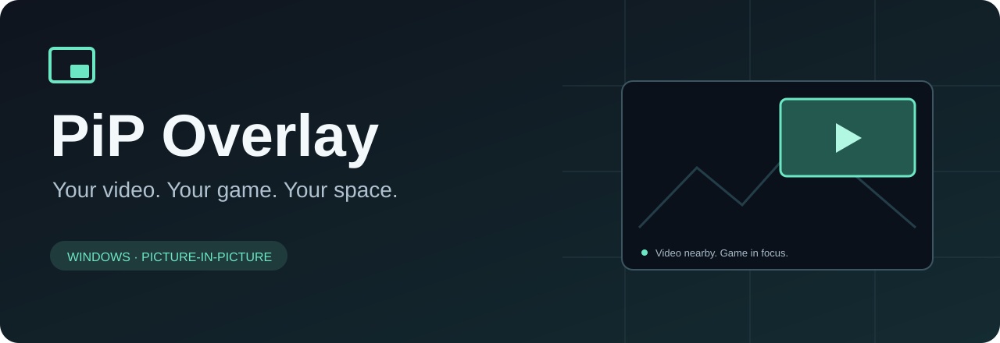

[Português](README.md) · **English**

Watch an Edge or Chrome video over your game, with adjustable position and size. Interaction stays in the editor: the in-game video receives neither clicks nor keyboard focus.

[**Download v0.16.1**](https://github.com/MaiconDAS/pip-overlay/releases/latest) · [User guide](docs/en/USAGE.md) · [Compatibility](docs/en/COMPATIBILITY.md) · [Report a problem](https://github.com/MaiconDAS/pip-overlay/issues/new/choose)

Windows x64 · Open source / MIT · No RTSS or extension

## What's new

**0.16.1** organizes Portuguese and English documentation and puts the version in the installer filename: `PiP-Overlay-v0.16.1.exe`. It retains the improvements introduced in **0.16**:

- **Game discovery:** identifies windows and renderers without depending on a particular game name. Unprepared processes appear as **não conectado** (not connected).
- **D3D11 GPU transport:** three shared textures with CPU fallback when needed.
- **Positioning:** PiP can touch all four screen edges, even with snapping enabled.
- **Appearance:** subtle rounded video corners.

[Release notes](docs/en/CHANGELOG.md) · [0.16 measurements and tests](docs/en/VALIDATION.md)

## Getting started

1. Download and run the installer. It bundles the runtime, creates shortcuts and registers Windows uninstallation. Updates preserve preferences.
2. Open PiP Overlay and put the video in **Edge or Chrome's native Picture-in-Picture**. Keep that window open and not minimized.
3. For DirectX 11/12, OpenGL and Vulkan, use **Iniciar jogo configurado** in the tray menu. Select the actual game executable. To change it, use **Ajustes → Mais → Trocar jogo**.
4. Drag the video in the editor and resize using its edges or corners. Connection starts when a source and supported renderer are available.

Resolution and FPS are independent. Selecting 30 fps keeps your chosen resolution limit; actual capture size depends on the browser and source. **Pausar** stops automatic reconnection. Closing the window keeps the app in the tray; choose **Sair** to exit. The application UI currently uses Portuguese; this is the English documentation edition.

[Complete installation, settings and uninstall guide](docs/en/USAGE.md)

## Visual editor

The editor represents the monitor proportionally. Settings live in the sidebar, preserving the main PiP workspace.

| I want to adjust | Where to find it |
| --- | --- |
| Resolution and FPS | Ajustes → Imagem |
| Monitor, position and snapping | Ajustes → Posição |
| Games, sources, shortcuts and updates | Ajustes → Mais |
| Center or undo | Editor toolbar; Ctrl+Z works inside the editor |
| Move without snapping | Hold Alt while dragging |

## Compatibility

| Component | Status |
| --- | --- |
| Windows | Windows 10 2004 or later / Windows 11, x64 |
| Browsers | Native Edge and Chrome PiP |
| DirectX 9 | Per-process D3D9 connection; dedicated-host tests, including fullscreen |
| DirectX 11/12 and OpenGL | Bundled integration; dedicated x86/x64 host tests |
| Vulkan | Experimental; 8-bit SDR with presentation limitations |
| GPU transport | Optimized for DirectX 11; other APIs retain CPU transport |

**Discovering a game does not guarantee that it accepts the overlay.** Protections, launchers and graphics configurations can prevent integration. Black Desert Online has not been validated. Newer-API fullscreen requires specific validation; synthetic tests do not certify every game or guarantee 60 fps.

[Limits and game discovery](docs/en/COMPATIBILITY.md) · [Test matrix](docs/en/TEST-MATRIX.md)

## Privacy and installation

Video is processed locally, without recording or uploading by the app. Optional update checks contact GitHub. Diagnostics are exported only at the user's request, with no automatic submission. [Read the privacy policy](PRIVACY.md).

The per-user installer bundles .NET and renderers and does not install services or drivers. Uninstallation preserves preferences and personal files. Public code signing remains pending; SHA-256 verifies integrity, not publisher identity. [Signing details](docs/en/SIGNING.md).

## Documentation and contributions

[English documentation](docs/en/README.md) · [Documentação em português](docs/README.md) · [Development](docs/en/DEVELOPMENT.md) · [Contributing](docs/en/CONTRIBUTING.md) · [Security](SECURITY.md)

C# / WinForms / .NET 8 and C++ / Direct3D. Installation changes are tested on disposable Windows first. Original code is [MIT licensed](LICENSE); dependencies retain their [original licenses](docs/en/THIRD_PARTY_NOTICES.md). An independent project by [MaiconDAS](https://github.com/MaiconDAS), unaffiliated with browser or game vendors.
