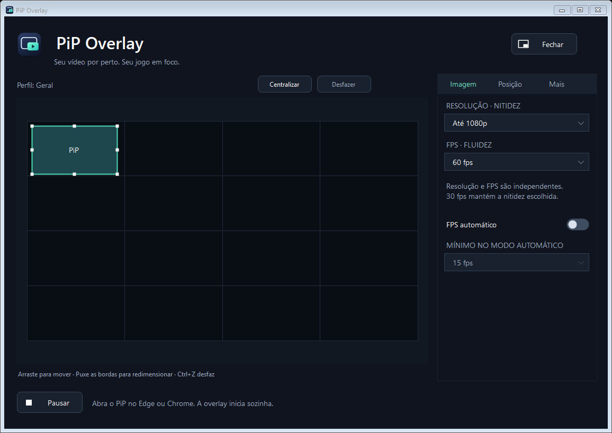

**Português** · [English](README.en.md)

Vídeo do Edge ou Chrome sobre seu jogo, com posição e tamanho ajustáveis. A interação fica no editor: o vídeo dentro do jogo não recebe cliques nem foco do teclado.

[**Baixar v0.16.1**](https://github.com/MaiconDAS/pip-overlay/releases/latest) · [Guia de uso](docs/pt-BR/USAGE.md) · [Compatibilidade](docs/COMPATIBILITY.md) · [Relatar problema](https://github.com/MaiconDAS/pip-overlay/issues/new/choose)

Windows x64 · Código aberto / MIT · Sem RTSS ou extensão

## Novidades da versão atual

A **0.16.1** organiza a documentação em português e inglês e identifica a versão no nome do instalador: `PiP-Overlay-v0.16.1.exe`. Ela mantém as melhorias da **0.16**:

- **Detecção de jogos:** identifica janelas e renderizadores sem depender do nome de um jogo específico. Processos ainda não preparados aparecem como **não conectado**.
- **Transporte GPU em DirectX 11:** três texturas compartilhadas, com retorno ao caminho CPU quando necessário.
- **Posicionamento:** o PiP pode encostar nas quatro bordas da tela, mesmo com encaixe ativo.
- **Acabamento:** cantos do vídeo discretamente arredondados.

[Notas da versão](CHANGELOG.md) · [Medições e testes da 0.16](docs/VALIDATION-0.16.md)

## Como usar

1. Baixe e execute o instalador. Ele inclui o runtime, cria atalhos e registra a desinstalação no Windows. Atualizações preservam preferências.
2. Abra o PiP Overlay e coloque o vídeo no **Picture-in-Picture nativo do Edge ou Chrome**. Mantenha a janela aberta, sem minimizar.
3. Para DirectX 11/12, OpenGL e Vulkan, use **Iniciar jogo configurado** no menu do ícone perto do relógio. Escolha o executável real do jogo. Para trocar, use **Ajustes → Mais → Trocar jogo**.
4. Arraste o vídeo no editor e use suas bordas ou cantos para redimensioná-lo. A conexão ocorre quando a fonte e um renderizador compatível estão disponíveis.

Resolução e FPS são independentes. Escolher 30 fps mantém o limite de resolução escolhido; o tamanho real da captura depende do navegador e da fonte. **Pausar** impede a reconexão automática. Fechar a janela mantém o app na bandeja; use **Sair** para encerrá-lo.

[Guia completo de instalação, ajustes e desinstalação](docs/pt-BR/USAGE.md)

## Editor visual

O editor representa o monitor proporcionalmente. Os ajustes ficam na lateral, preservando a área principal do PiP.

| Quero ajustar | Onde encontrar |
| --- | --- |
| Resolução e FPS | Ajustes → Imagem |
| Monitor, posição e encaixe | Ajustes → Posição |
| Jogos, fontes, atalhos e atualizações | Ajustes → Mais |
| Centralizar ou desfazer | Barra do editor; Ctrl+Z funciona no editor |
| Mover sem encaixe | Segure Alt ao arrastar |

## Compatibilidade

| Componente | Situação |
| --- | --- |
| Windows | Windows 10 2004 ou superior / Windows 11, x64 |
| Navegadores | PiP nativo do Edge e Chrome |
| DirectX 9 | Conexão por processo com D3D9; testes em host próprio, incluindo fullscreen |
| DirectX 11/12 e OpenGL | Integração incluída; testes em hosts próprios de 32/64 bits |
| Vulkan | Experimental; SDR de 8 bits, com limites de apresentação |
| Transporte GPU | Otimizado em DirectX 11; outras APIs mantêm transporte CPU |

**Detectar um jogo não garante que ele aceite a overlay.** Proteções, launchers e configurações gráficas podem impedir a integração. Black Desert Online ainda não foi validado. Fullscreen das APIs mais novas requer validação específica; testes sintéticos não certificam todos os jogos nem garantem 60 fps.

[Limites e detecção de jogos](docs/COMPATIBILITY.md) · [Matriz de testes](docs/TEST-MATRIX.md)

## Privacidade e instalação

O vídeo é processado localmente, sem gravação ou envio pelo app. Consultas opcionais de atualização acessam o GitHub. O diagnóstico é exportado somente por escolha do usuário, sem envio automático. [Leia a política de privacidade](docs/pt-BR/PRIVACY.md).

O instalador é por usuário, inclui .NET e renderizadores e não instala serviços ou drivers. A desinstalação preserva preferências e arquivos pessoais. A assinatura pública permanece pendente; o SHA-256 verifica integridade, não identidade do editor. [Detalhes da assinatura](docs/SIGNING.md).

## Documentação e contribuição

[Documentação em português](docs/README.md) · [English documentation](docs/en/README.md) · [Desenvolvimento](docs/DEVELOPMENT.md) · [Como contribuir](CONTRIBUTING.md) · [Segurança](docs/pt-BR/SECURITY.md)

C# / WinForms / .NET 8 e C++ / Direct3D. Testes de instalação são feitos primeiro em Windows descartável. Código próprio sob [MIT](LICENSE); dependências mantêm suas [licenças originais](THIRD_PARTY_NOTICES.md). Projeto independente de [MaiconDAS](https://github.com/MaiconDAS), sem afiliação com fabricantes de navegadores ou jogos.
