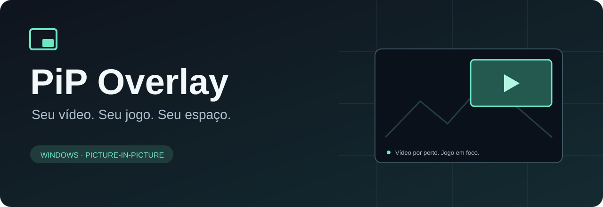
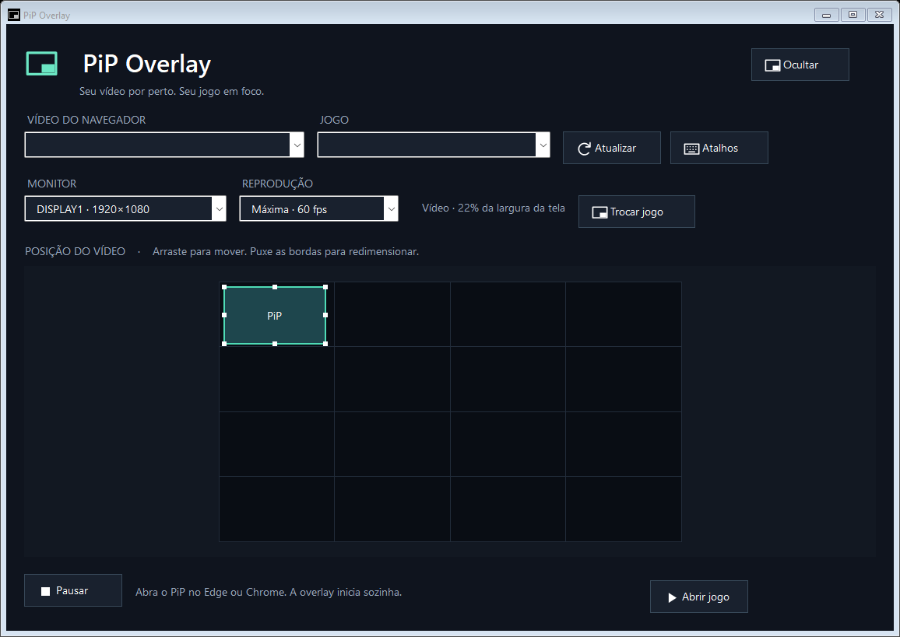

<p align="center">
  
</p>

<p align="center">
  <a href="https://github.com/MaiconDAS/pip-overlay/releases"></a>
  
  
  
</p>

<p align="center"><strong>Assista ao seu vídeo enquanto joga. Os cliques continuam no jogo.</strong></p>
<p align="center">
  <a href="https://github.com/MaiconDAS/pip-overlay/releases"><strong>Baixar instalador</strong></a> ·
  <a href="#como-usar">Como usar</a> ·
  <a href="docs/DEVELOPMENT.md">Compilar</a> ·
  <a href="https://github.com/MaiconDAS/pip-overlay/issues/new/choose">Relatar problema</a>
</p>

## O que é

PiP Overlay é um aplicativo para Windows que leva o Picture-in-Picture do Edge ou Chrome para dentro de jogos DirectX, OpenGL e Vulkan. Use o PiP sobre **seu jogo em fullscreen**, quando compatível com o renderizador. A imagem é desenhada pelo renderizador nativo, sem uma janela interativa sobre o jogo.

Você escolhe seu jogo uma vez, usa **Abrir jogo** e abre o PiP do navegador. A ferramenta conecta o vídeo automaticamente e mantém os controles fora da partida.

## Mudanças na versão 0.11

- **Mais nitidez:** captura em resolução nativa até 1080p no modo Máxima, evitando redução intermediária quando a fonte permite.
- **Mais renderizadores:** DirectX 11, DirectX 12 e OpenGL com motor incluído; Vulkan com camada própria, em 32 e 64 bits.
- **Abertura de Jogos:** botão **Abrir jogo**, seleção salva e reconexão ao mesmo processo após reabrir a ferramenta.
- **Controle de consumo:** opções de até 60, 30 e 15 fps; resolução e taxa efetiva no status.
- **Distribuição:** um instalador com dependências incluídas e interface sem ferramentas internas de teste.

Consulte o [histórico completo](CHANGELOG.md), a [compatibilidade com Jogos](docs/COMPATIBILITY.md) e os [resultados dos testes](docs/VALIDATION-0.11.md).

## Como usar

1. Baixe **`Instalar-PiP-Overlay.exe`** em [Releases](https://github.com/MaiconDAS/pip-overlay/releases).
2. Execute o instalador, escolha uma pasta nova e conclua a instalação. O .NET necessário já está incluído.
3. Deixe o aplicativo aberto e abra o vídeo em PiP no **Microsoft Edge** ou **Google Chrome**.
4. Clique em **Abrir jogo**. Na primeira vez, escolha o executável do jogo. O vídeo conecta automaticamente.

**Não é necessário instalar extensão, RTSS ou criar uma conta de desenvolvedor.** O PiP normal do navegador continua sendo a fonte de vídeo e precisa permanecer aberto, sem minimizar.

| Você quer… | Faça assim |
| --- | --- |
| Mover ou redimensionar | Arraste o vídeo ou as bordas no editor. |
| Escolher monitor, qualidade ou atalhos | Abra **Ajustes**. |
| Suspender o funcionamento | Use **Pausar**; a reconexão também fica suspensa. |
| Voltar a assistir | Use **Retomar** ou o atalho configurado. |
| Deixar rodando sem a janela | Feche a janela; o aplicativo fica perto do relógio. |
| Encerrar completamente | Clique em **Sair** no menu do ícone perto do relógio. |

O aplicativo não configura inicialização automática do Windows. Depois de reiniciar o computador, abra `PipOverlay.exe` novamente.

## Um editor que representa sua tela

<p align="center"></p>

Em **Ajustes**, escolha **Máxima · 60 fps** para preservar a resolução capturada até 1080p. A ferramenta amplia temporariamente o PiP de origem e restaura seu tamanho ao parar. O navegador pode impor um limite menor; a resolução real aparece no status.

A posição e o tamanho são proporcionais ao monitor selecionado. A interação com mouse e teclado fica no aplicativo; o renderizador não cria controles clicáveis dentro do jogo.

## Recursos

- **Conexão automática** quando o PiP e o jogo estão disponíveis.
- **Pausa persistente**, sem reiniciar a overlay contra a escolha do usuário.
- **Editor visual** com arraste e redimensionamento proporcional.
- **Atalhos configuráveis** para retomar e pausar.
- **Captura até 1920 × 1080**, sem redução intermediária no modo Máxima, limitada pela fonte.
- **Até 60 fps**, com alternativas de 30 e 15 fps.
- **Um instalador independente**, sem downloads extras durante a instalação.

## Compatibilidade com Jogos

| Item | Estado |
| --- | --- |
| Sistema | Windows 10 a partir da versão 2004 / Windows 11, x64 |
| Navegadores de origem | Edge e Chrome, usando o PiP nativo |
| DirectX 9 | Legado para processos reconhecidos; não é suporte genérico a todos os jogos D3D9 |
| DirectX 11 / DirectX 12 / OpenGL | Implementados e testados em hosts próprios, em 32 e 64 bits |
| Jogos | Inicialização do executável escolhido; launchers que criam outro processo e proteções podem impedir a conexão |
| Vulkan | Camada própria, testada em 32 e 64 bits; inicialmente SDR RGBA/BGRA UNORM de 8 bits |
| Distribuição | Projeto experimental, versão 0.11.0 |

Os testes automatizados cobrem lógica de conexão, atalhos e geometria. A renderização também foi exercitada em um aplicativo Direct3D 9 próprio, incluindo fullscreen. Isso **não equivale a uma certificação de compatibilidade com todas as versões do jogo ou drivers**. D3D11, D3D12, OpenGL e Vulkan passaram por verificações de pixels em hosts próprios; a captura nativa preservou os pixels de padrões em 720p e 1080p. Veja [os resultados e limites](docs/VALIDATION-0.11.md).

A tabela detalhada de [compatibilidade com Jogos](docs/COMPATIBILITY.md) diferencia implementação, testes em janela/fullscreen e casos ainda não validados. Não há lista de jogos certificados para as novas APIs.

Vídeos protegidos podem não ser capturáveis. O projeto não altera proteções do jogo nem tenta contorná-las.

## Desempenho, sem promessas de custo zero

O navegador continua decodificando o vídeo. Máxima preserva a resolução; os modos de economia reduzem na GPU. Os quadros seguem por leitura assíncrona e memória compartilhada. Não há codificação nem gravação de imagens por quadro.

Ainda existe transferência pela CPU e consumo de GPU. Um overlay maior custa mais. O modo Máxima custa mais que os modos reduzidos. **Ainda não há comparação controlada do impacto desta versão em jogos reais**. Em repouso, a busca ocorre a cada 1,5 segundo; seu consumo ainda não foi medido separadamente.

Para uma máquina mais limitada, comece com um vídeo pequeno e o modo **Econômico**. Saiba mais em [arquitetura e validação](docs/ARCHITECTURE.md).

## Desenvolvimento

O projeto usa **C# / WinForms / .NET 8** na interface e **C++ / Direct3D** na captura e renderização. O compilador nativo portátil é Zig 0.14.1; MinHook 1.3.4 está incluído com sua licença. O add-on usa MSVC portátil, e o pacote inclui ReShade 6.8.0; nada disso exige instalação manual pelo usuário.

```powershell
pwsh ./scripts/Initialize-Tools.ps1
pwsh ./scripts/Package.ps1
```

O instalador é gerado em `dist/installer/`. Consulte [DEVELOPMENT.md](docs/DEVELOPMENT.md) para requisitos, testes e compilação individual.

## Contribuir

Encontrou um problema? Abra uma [issue](https://github.com/MaiconDAS/pip-overlay/issues/new/choose) com a versão do aplicativo, navegador, Windows e passos para reproduzir. As orientações estão em [CONTRIBUTING.md](CONTRIBUTING.md).

O projeto ainda não definiu uma licença de código aberto para o código próprio. As licenças e atribuições das dependências estão em [THIRD_PARTY_NOTICES.md](THIRD_PARTY_NOTICES.md).

---

<p align="center">Criado por <a href="https://github.com/MaiconDAS">MaiconDAS</a> · Projeto independente, sem afiliação com Microsoft, Google, MSI ou desenvolvedores de jogos.</p>
