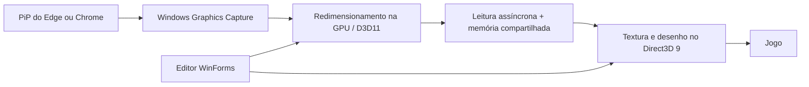

# Arquitetura e validação

O vídeo não é recodificado. O produtor usa buffers de leitura e evita esperar por uma GPU ocupada. Há cópias por CPU entre a captura e o renderizador: esta implementação não é zero-copy.

O renderizador preserva/restaura estados do dispositivo e desenha antes de `Present`. O auxiliar de carregamento aceita somente os nomes de processo explicitamente permitidos no código. Não é um injetor genérico. Ao pausar, o renderizador fica inativo; sua DLL permanece carregada até o processo do jogo terminar.

## Fluxo automático

`AutoConnect` permite uma tentativa por combinação de vídeo e processo. Falhas não geram uma sequência infinita de novas conexões. `Pausar` bloqueia novas tentativas; `Retomar` permite uma nova tentativa. As preferências ficam na própria pasta da instalação.

Quando não há sessão, uma consulta periódica de 1,5 segundo busca PiP e jogo. Com sessão ativa, essa busca de vídeo deixa de ocorrer; o aplicativo verifica se o processo do jogo continua disponível. Não é usada inicialização automática do Windows.

## Evidência disponível

- 14 verificações de lógica de conexão e persistência da pausa na versão 0.9.
- Testes de atalhos e geometria disponíveis no código.
- Validação sintética anterior da renderização em fullscreen: 25 verificações de pixels sem divergências, aproximadamente 29 fps enviados naquela execução.
- Testes de integridade da extração do instalador 0.10 e recusa a sobrescrever pasta existente.

Esses resultados têm escopos diferentes. Não representam benchmark controlado do Digimon, medição de consumo em repouso ou garantia de comportamento em outro computador. Os resultados históricos com caminhos locais não são publicados no repositório.

## Limites atuais

O PiP de origem precisa estar disponível à captura. Uma origem pequena limita a nitidez. O máximo de transporte é 1920 × 1080, e o tamanho solicitado acompanha o overlay. Direct3D 9 é o backend atual; outras APIs não estão implementadas. Conteúdo protegido pode bloquear a captura.
